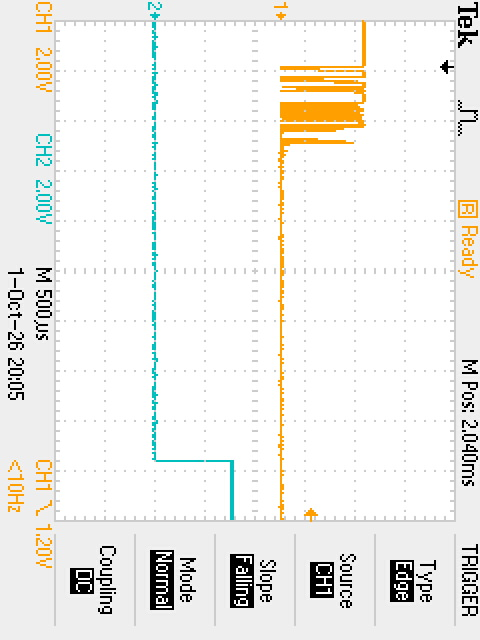
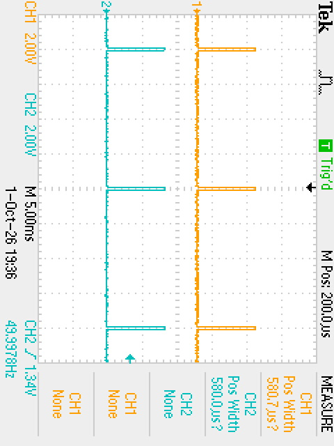
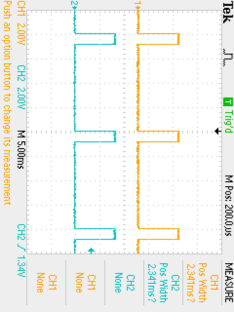

# ECE 528/L - Robotics and Embedded Systems with Lab
# Overview

	

# Components Used:

* TI MSP432 LaunchPad
* Pololu Gearmotor with Encoder - [Product Link](https://www.pololu.com/product/3675)
* Left Bumper Switches for TI-RSLK MAX - [Product Link](https://www.pololu.com/product/3673)
* Right Bumper Switches for TI-RSLK MAX - [Product Link](https://www.pololu.com/product/3674)
* HS-485HB Servo-Stock Rotation - [Product Link](https://www.servocity.com/hs-485hb-servo/)

# Known Issues or Limitations:

